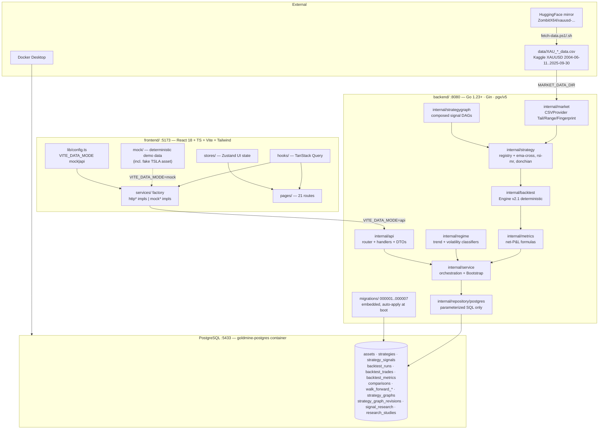

# Gold Mine Lab — Knowledge Graph

Machine-readable architecture context for this repository. Paste this file
into any AI model to give it an accurate map of what exists and how it
connects. For deep design rationale see `KNOWLEDGE.md`; for run commands see
`README.md`, `backend/README.md`, `frontend/README.md`.

## 1. One-paragraph summary

Gold Mine Lab is a quantitative strategy research and backtesting platform.
Historical market CSVs (XAUUSD, 2004-2025) feed a Go/Gin/PostgreSQL backend
that generates strategy signals, runs a deterministic next-candle-open
backtest engine, persists every experiment with provenance, and exposes a
REST API consumed by a React/TypeScript/Vite research terminal. No live
market data, no auth, no async queue — deliberately.

## 2. System graph



## 3. Node catalog

### Runtime / ops nodes

| ID | Type | Location | Role |
|---|---|---|---|
| `scripts/app.ps1` | script | repo root scripts/ | start/stop/status/restart the whole stack; injects `VITE_DATA_MODE=api` |
| `scripts/fetch-data.{ps1,sh}` | script | repo root scripts/ | download + verify market CSVs into `data/` |
| `backend/docker-compose.yml` | config | backend/ | `goldmine-postgres` container, host port 5433 |
| `backend/Makefile` | config | backend/ | run/build/test/vet/db-up/db-down |
| `backend/.env` | config | gitignored | `DATABASE_URL`, `MARKET_DATA_DIR` (required), ports, CORS |
| `frontend/.env` | config | gitignored | `VITE_DATA_MODE` (mock\|api), `VITE_API_URL`, `VITE_WS_URL` |

### Backend packages (`backend/internal/`)

| Package | Depends on | Role |
|---|---|---|
| `cmd/server` | all | thin wiring: config → migrate → pool → repos → service → bootstrap → serve |
| `config` | — | env loading, fail-fast validation |
| `database` | config | pgxpool + Ping |
| `api` | service | Gin router, middleware, `{error:{code,message,request_id}}` envelope, wire DTOs |
| `market` | — | Asset/Candle/Timeframe; `CSVProvider` streaming validated reads (`Tail`, `Range`+warmup, `Fingerprint`) |
| `strategy` | market | `Strategy` contract, static `Registry`, `Streamer` O(1)/bar iface; `indicators/EMA`, `indicators/RSI` |
| `strategygraph` | strategy, market | declarative DAG composer → ONE composite signal; `Validate`, immutable revisions |
| `backtest` | strategy, market | deterministic engine v2.1; next-candle-open fills, long-only, net P&L |
| `metrics` | — | net P&L, win rate, PF, maxDD, expectancy, streaks, exposure formulas |
| `regime` | market | streaming classifiers: trend (EMA50/200), volatility (Wilder ATR-14 vs EMA-100 baseline) |
| `eventbench` | — | forward-return baseline + moving-block bootstrap stats (Phase 11) |
| `live` | market | managed live provider (`LIVE_MARKET_PROVIDER`: `twelvedata` REST poll/WS or `tiingo` FX firehose WS): shared quote cache + candle books, backoff, staleness, redacted errors, `priceKind` last/mid — observational only, never touches research |
| `repository` + `/postgres` | — | repo interfaces + pgx impls; parameterized SQL only, no logic |
| `service` | all above | implements `api.*Service`; `Bootstrap` seeding; comparisons, walk-forward, signal research, studies; `LiveService` adapts the live provider |
| `demo` | — | legacy deterministic service — tests only |
| `portfolio` | — | scaffolding, unused |

### Built-in strategies (registry slugs)

| Slug | Version | Rule | Params |
|---|---|---|---|
| `ema-cross` | 1.0.0 | EMA20/50 crossover at bar close | fast_period, slow_period |
| `rsi-mean-reversion` | 1.0.0 | RSI up-cross oversold = BUY; down-cross overbought = SELL | rsi_period, oversold, overbought |
| `donchian-breakout` | 1.0.0 | close > prior-N-high = BUY; close < prior-N-low = SELL | lookback_period |
| `graph:<uuid>:v<n>` | per revision | materialized strategy-graph revision | from revision JSON only |

### Database tables (migrations 000001-000007)

| Table | Purpose | Key relations |
|---|---|---|
| `assets` | instrument catalog (slug pk: `xauusd`) | ← signals, runs |
| `strategies` | strategy defs incl. `graph:` slugs, supported_timeframes jsonb | ← signals, runs |
| `strategy_signals` | persisted signals; UNIQUE(strategy,asset,ts) → idempotent regeneration | → assets, strategies |
| `backtest_runs` | experiment rows: params, window, costs, equity_curve jsonb, engine_version, strategy_version, dataset fingerprint | → trades/metrics (cascade); links comparison_id, walk_forward_id, fold, sample |
| `backtest_trades` | fills incl. gross_pnl, entry/exit_commission | → backtest_runs |
| `backtest_metrics` | EAV metrics; absent row = undefined = API null | → backtest_runs |
| `comparisons` | 2-4 legs under identical assumptions; member runs via `comparison_id` | → backtest_runs |
| `walk_forward_*` | rolling IS/OOS fold experiments | → backtest_runs via `walk_forward_id` + folds table |
| `strategy_graphs` + `strategy_graph_revisions` | named graphs + IMMUTABLE revision definitions (definition_hash sha256) | → strategies rows materialized per revision |
| `signal_research` | cross-strategy replay results as JSONB (pending→completed/failed) | standalone |
| `research_studies` | pre-registered studies: draft→frozen→exploratory_complete→holdout_consumed + holdout reservations | reserves evaluation windows |

### Frontend modules (`frontend/src/`)

| Area | Role |
|---|---|
| `lib/config.ts` | `dataMode` from `VITE_DATA_MODE`; `getApiUrl`/`getWsUrl` (+ localStorage overrides) |
| `services/interfaces.ts` + `services/index.ts` | contract + factory: `api` → `services/api/http*`, `mock` → `services/mock/mock*` |
| `services/api/*` | thin REST pass-throughs, zod-validated, `apiClient` normalizes error envelope |
| `services/mock/*` + `mock/*` | deterministic seeded demo data (includes fake TSLA/MSFT assets) |
| `hooks/` | TanStack Query hooks — all server data |
| `stores/` | Zustand — UI state only, never server data |
| `pages/`, `components/` | pages per route; charts via lightweight-charts + echarts |
| `types/` | zod schemas mirroring API contract |

## 4. REST API map (`/api`)

| Method + path | Service | Purpose |
|---|---|---|
| GET `/health` | health | liveness + DB ping |
| GET `/assets` | market | asset catalog |
| GET `/market/candles?asset&timeframe` | market | CSV candles + EMA overlays |
| GET `/market/summary` | market | last real close + change (status Historical) |
| GET `/strategies`, GET `/strategies/:id` | strategy | defs + latest signal + latest-run metrics |
| GET `/signals` | service | persisted signals |
| GET `/backtests`, `/backtests/:id`, `/backtests/latest`, `/backtests/summary` · POST `/backtests` | backtest | run history + synchronous engine execution (201) |
| GET `/comparisons`, `/comparisons/:id` · POST `/comparisons` | comparison | multi-strategy identical-assumption runs, optional OOS |
| GET `/walkforwards`, `/walkforwards/:id` · POST `/walkforwards`, `/walkforwards/preview` | walkForward | rolling IS/OOS fold experiments |
| GET `/strategy-graphs`, `/:id`, `/:id/versions` · POST `/strategy-graphs`, `/validate`, `/:id/versions`, `/:id/versions/:v/backtests`, `/:id/versions/:v/diagnostics` | graph | CRUD + validate + run + signal inspector |
| GET `/trades` | trade | filtered paginated fills |
| GET `/signal-research`, `/:id` · POST `/signal-research` | signalResearch | cross-strategy replay stats + forward study + bootstrap |
| GET `/market/live/status` · `/market/live/quote?asset` · `/market/live/candles?asset&timeframe&limit` · WS `/market/live/stream` | live | provider-backed XAU/USD quote/candles; xauusd only, else 400. `/stream` pushes `status`/`quote`/`bars` frames per provider tick (fan-out hub, snapshot semantics) — drives the browser chart without polling |
| GET `/research-studies`, `/:id` · POST ``, `/:id/freeze`, `/:id/exploratory-runs`, `/:id/validate-holdout` · PATCH `/:id` | researchStudy | pre-registration lifecycle + holdout management |

## 5. Frontend route map

```
/  (Dashboard — latest run metrics + equity)
/market                /strategies  /strategies/:id
/backtests             /results  /results/:runId       /trades
/compare  /compare/:id /walkforward  /walkforward/:id
/graphs   /graphs/:id  /research  /research/:id
/studies  /studies/new /studies/:id
/settings              * (NotFound)
```

## 6. Core flows

### App startup (`scripts/app.ps1 start`)
```
docker compose up -d postgres → wait healthy (60s)
  → go build bin/server.exe (if missing / -Build)
    → load backend/.env (else defaults: DATABASE_URL→:5433, MARKET_DATA_DIR→data/)
      → server: migrations.Up → pgx pool → CSV provider → registry
        → Bootstrap (idempotent: upsert asset+strategies, generate signals, 3 seed backtests if empty)
          → serve :8080
  → node vite.js (VITE_DATA_MODE=api, VITE_API_URL injected) → serve :5173
PIDs + logs → scripts/.run/{state.json,logs/}
```

### Backtest request (`POST /api/backtests`)
```
JSON request → handler validates → service.Execute
  → resolveStrategy (registry | graph:<uuid>:v<n> lazy rebuild)
  → CSVProvider.Range(start, end+1d, warmup=strategy-derived)
  → strategy.Stream per bar: signal at close(i) → fill at open(i+1)
  → engine accounting: qty=equity·size%/fill; adverse slippage; per-fill commission
  → mark-to-market equity each bar; final bar force-liquidate inside curve
  → metrics on NET trade P&L
  → CompleteRun: trades+metrics+equity+status=completed in ONE transaction
    (failure → status=failed + safe message)
```

### Signal research (`POST /api/signal-research`)
```
2-8 candidates (built-ins or graph revisions), shared dataset
  → ONE Range fetch, per-candidate NewStream, shared chronological replay
  → stats: action counts, episodes, pairwise agreement/conflict
  → optional regimeAnalysis: trend+volatility labels per bar
  → optional eventStudy: BUY-episode forward returns @ 1/5/10/20 bars
    + matched baseline (baseline-v1) + moving-block bootstrap CI (mbb-v2)
  → persist JSONB on signal_research (pending→completed|failed)
```

### Research study lifecycle
```
draft → (freeze: sha256 spec hash + holdout window reservation,
         advisory-locked) → exploratory_complete → holdout_consumed
Analytical endpoints REJECT windows overlapping an active holdout.
```

## 7. Invariants any AI assistant must preserve

1. **No look-ahead** — signal at close(i), fill at open(i+1), always.
2. **Net P&L** — `pnl` = net after both commissions; win/loss on net; legacy
   rows keep gross and are labeled `engine_version='legacy'`, never rewritten.
3. **Undefined = absent = null** — metrics never report 0/Inf/NaN stand-ins.
4. **Determinism** — same inputs → same outputs (engine, strategies, graphs,
   bootstrap seeds). Provenance on every run: dataset sha256 fingerprint +
   engine/strategy versions (+graphId/graphRevision for graph runs).
5. **Layer rule** — Handler→Service→Domain→Repository→Postgres.
   No Handler→SQL, no Strategy→I/O, no mock data in the api path.
6. **Immutability** — graph revisions append-only; frozen studies immutable;
   pre-P11/v1 benchmark records keep their original metadata.
7. **Honest status** — the optional live feed (Twelve Data/Tiingo, XAUUSD
   only) is observational and reports real state; historical mode stays the
   default. Frontend `mock` mode is demo-only and labeled.

## 8. Compact JSON graph (for programmatic ingestion)

```json
{
  "system": "GoldMineLab",
  "kind": "quantitative backtesting platform",
  "nodes": {
    "external": ["XAUUSD CSVs (data/)", "HuggingFace mirror", "Docker Desktop"],
    "frontend": ["React+Vite :5173", "services factory (api|mock)", "TanStack Query hooks", "Zustand stores", "21 routes", "mock demo data"],
    "backend": ["Gin REST :8080", "service orchestration", "backtest engine v2.1", "strategy registry (ema-cross, rsi-mean-reversion, donchian-breakout)", "strategygraph DAGs", "metrics", "regime classifiers", "eventbench stats", "CSVProvider", "postgres repository", "migrations 1-7"],
    "postgres": ["assets", "strategies", "strategy_signals", "backtest_runs", "backtest_trades", "backtest_metrics", "comparisons", "walk_forward_*", "strategy_graphs(+revisions)", "signal_research", "research_studies"]
  },
  "edges": [
    ["CSVs", "read by", "CSVProvider"],
    ["CSVProvider", "feeds", "strategy streams"],
    ["strategies", "emit signals to", "backtest engine + strategy_signals"],
    ["engine", "writes runs/trades/metrics to", "Postgres (atomic tx)"],
    ["strategygraph", "composes", "registry strategies → composite signal"],
    ["regime+eventbench", "annotate", "signal_research analyses"],
    ["service", "orchestrates", "api handlers"],
    ["api", "exposes", "REST /api/* → frontend http* services"],
    ["frontend", "selects impl via", "VITE_DATA_MODE (api default via app.ps1)"],
    ["app.ps1", "manages", "postgres container + backend + frontend"]
  ],
  "ports": {"postgres": 5433, "api": 8080, "frontend": 5173},
  "absent_by_design": ["auth", "broker/trading connectivity", "async queue", "Sharpe"]
}
```
